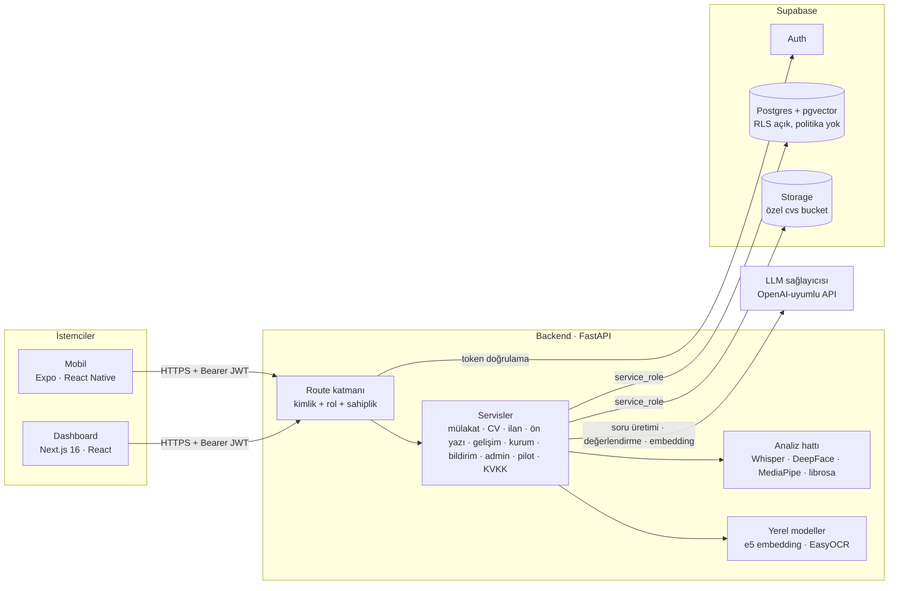
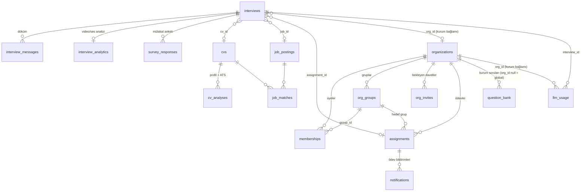
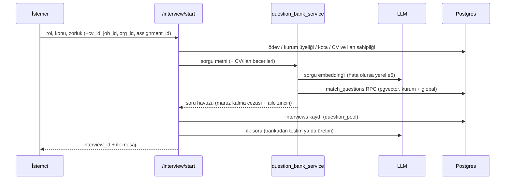

# Mimari

DeepInsight üç istemci-sunucu bileşeninden oluşan bir monorepodur. Tüm iş mantığı ve
yetki kontrolü backend'dedir; istemciler veritabanına doğrudan erişmez.

## Bileşenler

| Bileşen | Teknoloji | Sorumluluk |
|---|---|---|
| `backend/` | FastAPI, Pydantic, supabase-py | API, yetki, iş kuralları, LLM ve analiz hattı |
| `dashboard/` | Next.js (App Router), Tailwind, Recharts, Zustand | Aday, eğitmen ve kurum yöneticisi web arayüzü |
| `mobile/` | Expo, React Native, Zustand | Aday mobil uygulaması (kamera/ses ile mülakat) |
| Supabase | Postgres + pgvector, Auth, Storage | Kalıcı veri, kimlik, CV dosyaları |

## Modüller (fazlar)

| Faz | Modül | Ana servis(ler) | Arayüz |
|---|---|---|---|
| Çekirdek | Yazılı/sesli/görüntülü mülakat, RAG soru bankası | `interview_service`, `question_bank_service`, `llm_service`, `analytics` | `/chat/text`, `/chat`, `/interviews` |
| 0 | Çok kiracılı yapı (kurum, üyelik, denetim kaydı, kota) | `organization_service` | `/organizations` |
| 1 | CV yükleme, OCR, ATS uyumluluk skoru, CV'ye özel mülakat | `cv_text_service`, `ats_service`, `cv_analysis_service` | `/cv` |
| 2 | İlan gereksinim çıkarımı, uyum skoru, yol haritası | `job_service`, `skill_matching` | `/jobs` |
| 3 | Gelişim analizi, öneriler, PDF rapor | `progress_service`, `progress_report` | `/progress` |
| 4A | Kurum paneli, rızaya bağlı öğrenci görünümü | `org_insights_service` | `/organizations/[id]` |
| 4B | Ödev atama | `assignment_service` | kurum paneli, `/assignments` |
| 4C | Gruplar, toplu davet, rubrik, CSV dışa aktarma | `org_group_service`, `org_export_service` | kurum paneli |
| 5 | Pilot çalışma, KVKK veri hakları, akademik ölçümler | `pilot_service`, `account_service`, `scripts/eval/` | `/pilot`, `/pilot/report`, Profil |
| + | STAR koçluğu (davranışsal mülakat, kural tabanlı) | `star_service` | mülakat ekranları |
| + | İngilizce mülakat modu (`interviews.language`) | `prompts/interview_v1`, `analytics` | mülakat kurulumu |
| + | Bildirimler ve ödev hatırlatma | `notification_service` | zil (web), Bildirimler (mobil), kurum paneli |
| + | Kurum PDF raporu, kurum yapay zekâ kullanımı/maliyeti | `org_report`, `org_usage_service` | kurum paneli |
| + | Ön yazı üretici (kaydedilmez) | `cover_letter_service` | `/jobs` |
| + | Zayıf konulara pratik seti | `practice_service` | `/progress`, mobil Raporlar |
| + | Platform admin paneli: kullanım ve yapay zekâ envanteri | `admin_service` | `/admin` |

## Veri modeli (özet)

Kullanıcıya ait tablolar (`interviews`, `cvs`, `job_postings`, `user_consents`,
`survey_responses`, `memberships`, `notifications`) `user_id` ile Supabase Auth kullanıcısına
bağlanır. `llm_usage` her model denemesini (amaç, model, gecikme, token; içerik yok) tutar;
yalnızca kurum bağlamındaki mülakat çağrıları `org_id` taşır.
Şema `backend/sql/001…024` migration'larıyla kurulur (Supabase SQL Editor ya da MCP
`apply_migration`); her dosyanın başında amacı ve çalıştırma notu vardır.

## Temel akışlar

### Mülakat başlatma (RAG + kişiselleştirme)

Mülakat sonu sunucu tarafındaki soru sayacıyla belirlenir (LLM'in "bitirdim" demesine
güvenilmez); nihai değerlendirme atomik "claim" ile tek kez yapılır. Tüm modeller başarısız
olursa claim geri alınır, mülakat 0 puanla kapatılmaz; istemci `evaluation_failed` alır ve
`/finish` ile tekrar dener. "Bu setle mülakat yap"ta (`question_ids`) havuz pratik setinin
sorularından, verilen sırayla kurulur.

### Dil modeli çağrıları

Tüm çağrılar `llm_service` üzerinden: modeller sırayla denenir (`gpt-oss-20b` →
`nemotron-3-super-120b-a12b`); üst üste hatada model başına devre kesici devreye girer.
`gpt-oss-20b` JSON modunda boş yanıt döndüğü için ona JSON modu gönderilmez, JSON metinden
ayıklanır. Deneme süresi genel 30 sn, yapılandırılmış çıktıda 60 sn, ön yazıda 110 sn. Her deneme
`llm_usage`'a yazılır; istek bağlamı (`bind_usage_context`) mülakatı ve kurumu ekler. Hangi
özelliğin hangi amaç (purpose) adıyla kayıt düştüğü `org_usage_service.PURPOSES`'ta tek yerde
tutulur ve admin panelindeki envanter buradan üretilir.

### CV analizi

PDF/DOCX/görsel → metin katmanı (PyMuPDF) ya da OCR (EasyOCR) → kural tabanlı ATS skoru
(8 kontrol, 100 puan, açıklamalı) → iletişim bilgisi maskelenip LLM ile yapılandırılmış profil
→ deterministik kıdem tahmini. CV metni LLM'e "talimat değil veri" olarak, açı parantezleri
temizlenmiş biçimde verilir.

### Kurum görünürlüğü

Eğitmen yalnızca kurum bağlamında yapılmış mülakatları görür. Öğrenci bazında skor için
öğrencinin `share_progress` rızası gerekir; rıza yokken bile toplu istatistik ancak en az
3 farklı öğrenci katkı verdiyse (`MIN_COHORT`) gösterilir. Grup görünümünde aynı kural
daraltılmış veriye ayrıca uygulanır.

## Tasarım kararları

- **Deterministik ve açıklanabilir skorlar:** ATS, ilan uyumu, gelişim önerileri ve rubrik
  hesapları kurallarla yapılır; LLM yalnızca metin üretimi (soru, özet, yol haritası) ve
  mülakat değerlendirmesi için kullanılır ve LLM çökerse koddan bir yedek üretilir.
- **Yetki backend'de:** veritabanı erişimi service_role ile yapılır (RLS açık, politika yok =
  istemciler doğrudan erişemez). Her route kimlik, kurum rolü (`require_org_role`) ve kaynak
  sahipliğini doğrular. Bkz. [SECURITY_AND_KVKK.md](SECURITY_AND_KVKK.md).
- **Supabase istemcisi iş parçacığından çağrılmaz:** paylaşılan HTTP/2 istemcisi eşzamanlı
  iş parçacıklarında bağlantıyı koparıyor; yalnızca CPU işleri (PDF, OCR, yerel embedding)
  `asyncio.to_thread` ile çalışır. Kimlik doğrulama dependency'si de bu yüzden `async`.
- **Kota:** kurum bağlamındaki mülakatlar aylık kotaya tabidir (LLM maliyet kontrolü).
- **Zamanlayıcısız bildirim:** son tarih hatırlatmaları kullanıcı bildirimlerini açtığında
  üretilir; `(user_id, dedupe_key)` benzersizliği aynı bildirimin iki kez oluşmasını engeller.
- **LLM çıktısına kodla sınır:** ön yazıda CV'de dayanağı olmayan sayı/beceri/kısaltmalar,
  pratik setinde konu dışı ve zor sorular, kurum özetinde personel mülakatları kuralla elenir.

## Test ve ölçüm

- `backend/tests/`: ~480 birim/entegrasyon testi (Supabase ve LLM mock'lu), sahiplik ve
  tenant izolasyonu regresyon testleri dahil. `pytest tests -q`
- `e2e/`: ~100 Playwright testi (web paneli ve mobil uygulamanın web sürümü, backend taklitli);
  GitHub Actions'ta her PR'da çalışır. Bkz. [e2e/README.md](../e2e/README.md)
- `dashboard`: `npx tsc --noEmit`, `npx eslint src` · `mobile`: `npx tsc --noEmit`, `npx expo lint`
- `backend/scripts/eval/`: akademik ölçümler, bkz. [evaluation/README.md](evaluation/README.md)
